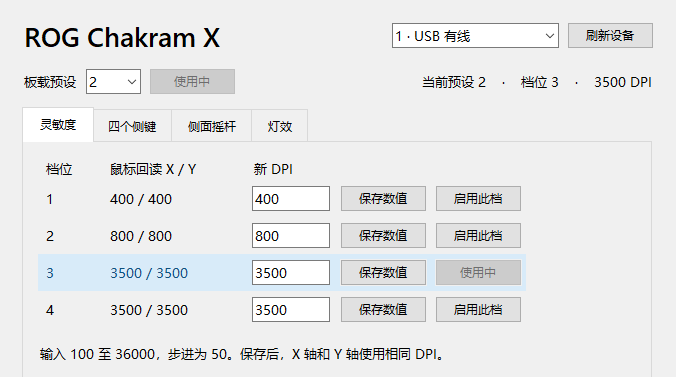
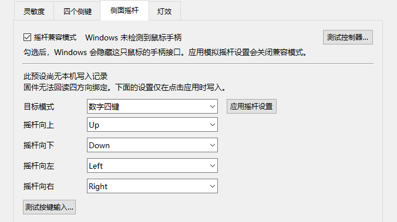
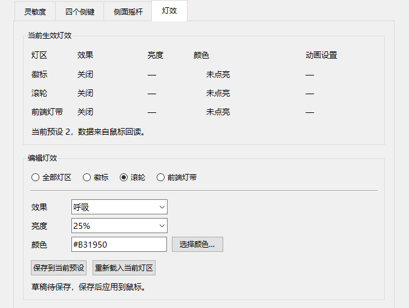

# Chakram X Control

[简体中文](README.md) · **English**

An offline Windows x64 tool for the ROG Chakram X. Configure DPI, side buttons, the thumb joystick and RGB lighting over USB HID. Settings are stored in the mouse’s onboard profiles, so you can close the app afterward. Armoury Crate is optional.

**[Download for Windows x64](https://github.com/RhoninSeiei/ChakramXControl/releases/latest/download/ChakramXControl.exe)** · [Release notes and SHA-256 checksums](https://github.com/RhoninSeiei/ChakramXControl/releases/latest)

> **Unofficial project.** This community tool is independent of ASUS and ROG and has no official authorization, sponsorship or endorsement from either. Product names and trademarks belong to their respective owners.

## Quick start

The application interface is in Simplified Chinese. The labels below match the buttons on screen.

1. Connect the mouse by USB and run `ChakramXControl.exe`. If the mouse is missing, click **刷新设备** (Refresh devices).
2. Choose an onboard profile (1–5) and click **切换预设** (Switch profile).
3. On **灵敏度** (Sensitivity), enter a DPI value and click **保存数值** (Save value) in that row. To activate it immediately, click **启用此档** (Activate stage).



The highlighted row follows the active stage, even when you switch using the physical DPI button.

## Side buttons, joystick and lighting

**Side buttons.** On **四个侧键**, choose an action for A–D and click **保存按键** (Save binding) in that row. **当前生效** shows the binding read back from the mouse.

<details>
<summary><strong>Thumb joystick</strong> · Use analog axes or four independent keys</summary>

In profiles 1–4, open **侧面摇杆** (Thumb joystick). Choose **模拟摇杆** for analog axes or **数字四键** to bind up, down, left and right separately. Click **应用摇杆设置** (Apply joystick settings), then use the controller or key test on the same tab.



Checking **摇杆兼容模式** (Joystick compatibility mode) hides the mouse’s gamepad interface from Windows, which is useful with a separate controller. Applying analog mode turns compatibility mode off. The firmware cannot report the four direction bindings, so the app shows its last local write record.

</details>

<details>
<summary><strong>RGB lighting</strong> · Set the logo, wheel or front strip separately</summary>

On **灯效** (Lighting), select a zone, effect, brightness and color. Click **保存到当前预设** (Save to current profile). In the screenshot, all three zones are still off. The breathing effect at 25% brightness is an unsaved edit for the wheel. Select **全部灯区** (All zones) for rainbow, comet or battery indication.



</details>

## Compatibility and development

Configuration reads, writes and gamepad enumeration have been tested over a USB cable (`0B05:1A18`). The original 2.4 GHz receiver (`0B05:1A1A`) is supported in code and awaits hardware testing. Physical joystick input and the full feature set on a clean Windows installation also await verification. [HID protocol and verification details (Chinese)](docs/hid-protocol.md)

<details>
<summary>Run from source or build an executable</summary>

Use Windows x64, Python 3.13 with Tk, and PowerShell 7.

```powershell
py -3.13 -m venv .venv
.\.venv\Scripts\python.exe -m pip install -r requirements-build.txt
.\.venv\Scripts\python.exe app.py
```

Run `./scripts/build.ps1 -Python .\.venv\Scripts\python.exe` to run tests and build into `dist`. Pushing an annotated tag such as `v0.1.1` triggers the [release workflow](.github/workflows/windows.yml).

</details>

[MIT license](LICENSE) · [Third-party notices](THIRD_PARTY_NOTICES.md)
