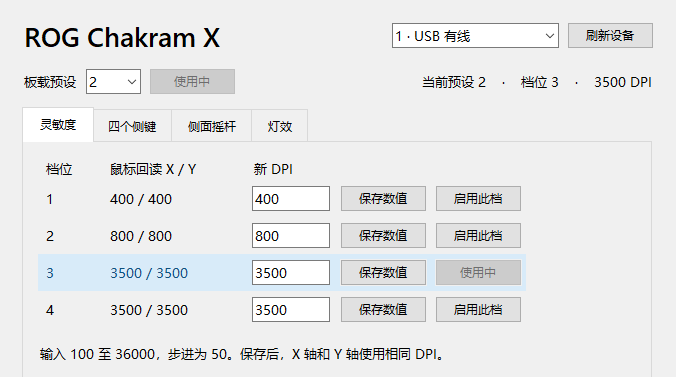
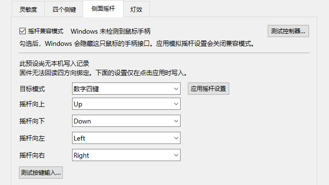
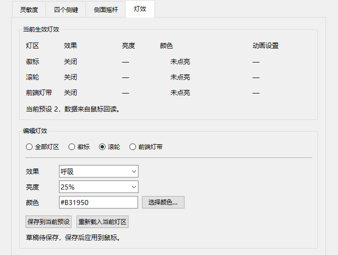

# Chakram X Control

**简体中文** · [English](README.en.md)

Windows x64 上的 ROG Chakram X 配置工具。通过 USB HID 调节 DPI、侧键、摇杆和 RGB 灯效，写入板载预设后即可退出。程序离线运行，无需安装 Armoury Crate。

**[下载 Windows x64 版](https://github.com/RhoninSeiei/ChakramXControl/releases/latest/download/ChakramXControl.exe)** · [发行说明与 SHA-256 校验清单](https://github.com/RhoninSeiei/ChakramXControl/releases/latest)

> **非官方声明**　本项目由社区独立开发，未经 ASUS 或 ROG 授权、赞助或认可。相关产品名称和商标归各自权利人所有。

## 快速上手

1. 用 USB 线连接鼠标，双击 `ChakramXControl.exe`。如果设备未出现，点击右上角的「刷新设备」。
2. 选择要编辑的板载预设（1–5），点击「切换预设」。
3. 在「灵敏度」输入新 DPI，点击同一行的「保存数值」。要立即使用这一档，再点「启用此档」。



高亮行表示鼠标实际使用的档位。用实体键切档时，窗口会自动更新。

## 侧键、摇杆和灯效

**四个侧键**　在「四个侧键」页为 A–D 选择动作，点击对应的「保存按键」。「当前生效」列显示设备回读值。

<details>
<summary><strong>侧面摇杆</strong> · 设置模拟轴或四个独立按键</summary>

在预设 1–4 中打开「侧面摇杆」，选择「模拟摇杆」或「数字四键」。数字模式可分别绑定上、下、左、右。点击「应用摇杆设置」，再用页面上的测试按钮检查输入。



勾选「摇杆兼容模式」会向 Windows 隐藏鼠标的手柄接口，适合另接手柄时使用。应用模拟模式会自动关闭兼容模式。固件无法回读四方向绑定，页面显示本机上次写入的记录。

</details>

<details>
<summary><strong>RGB 灯效</strong> · 单独设置徽标、滚轮或前端灯带</summary>

选择灯区、效果、亮度和颜色，点击「保存到当前预设」。下图中三个灯区仍处于关闭状态，滚轮的 25% 亮度呼吸效果是待保存草稿。要设置彩虹、彗星或电量指示，请选「全部灯区」。



</details>

## 兼容性和开发

有线连接（`0B05:1A18`）已实机验证配置读写和手柄枚举。原配 2.4 GHz 接收器（`0B05:1A1A`）有代码支持，尚待实测。摇杆实际拨动输入和干净 Windows 环境中的全功能验证仍待完成。[HID 协议与验证范围](docs/hid-protocol.md)

<details>
<summary>从源码运行或构建</summary>

在 Windows x64 上使用 Python 3.13（含 Tk）和 PowerShell 7。

```powershell
py -3.13 -m venv .venv
.\.venv\Scripts\python.exe -m pip install -r requirements-build.txt
.\.venv\Scripts\python.exe app.py
```

运行 `./scripts/build.ps1 -Python .\.venv\Scripts\python.exe` 执行测试并生成 `dist`。推送形如 `v0.1.1` 的带注释标签可触发[发布工作流](.github/workflows/windows.yml)。

</details>

[MIT 许可证](LICENSE) · [第三方许可](THIRD_PARTY_NOTICES.md)
